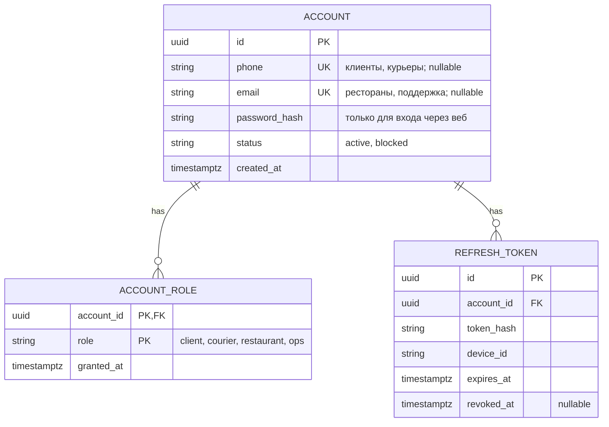
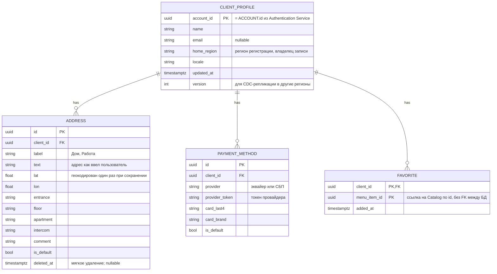
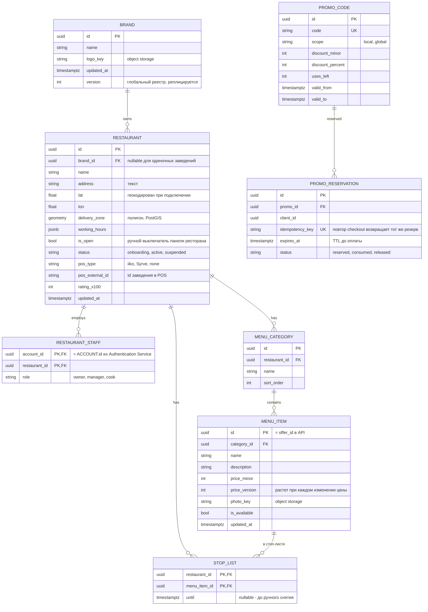
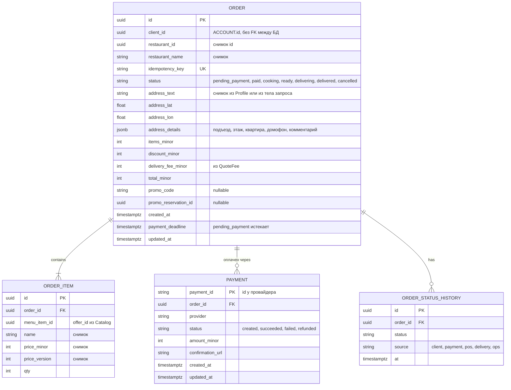
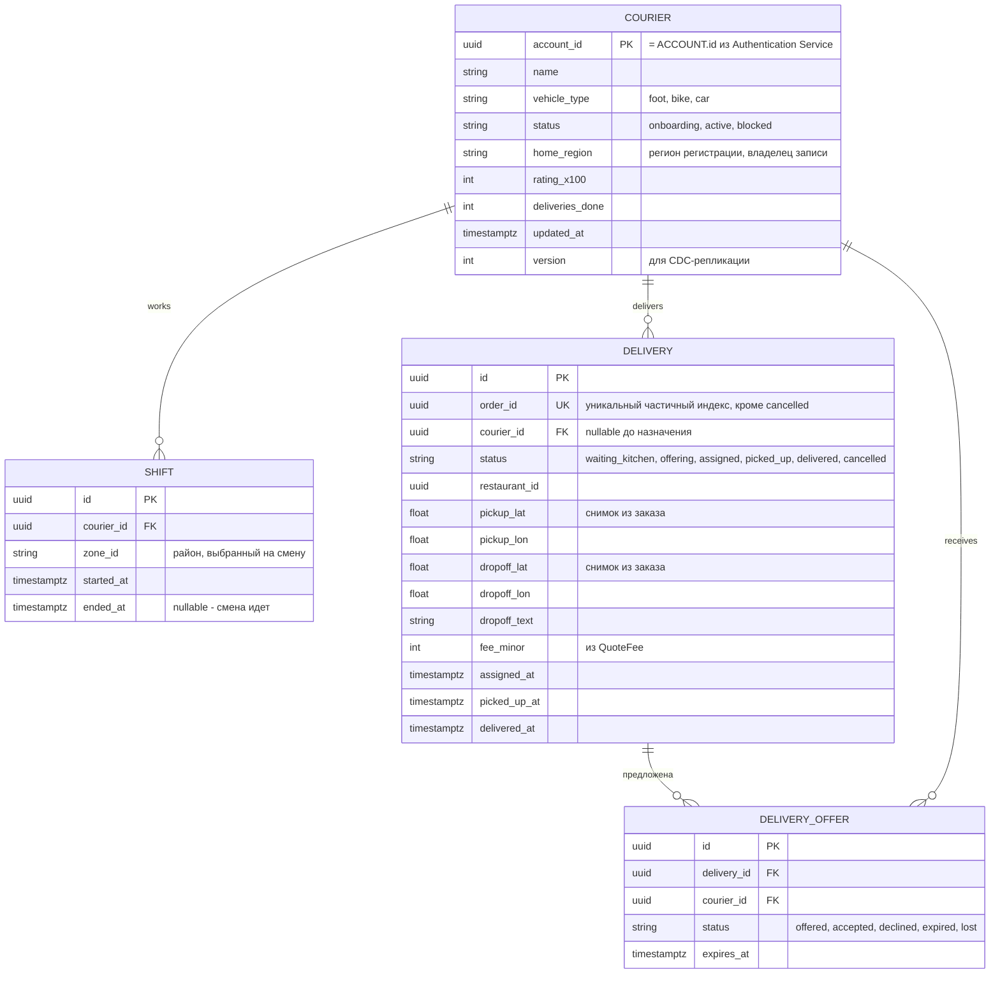
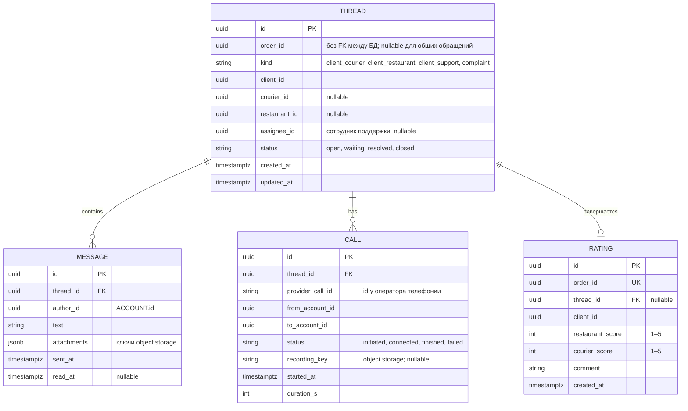
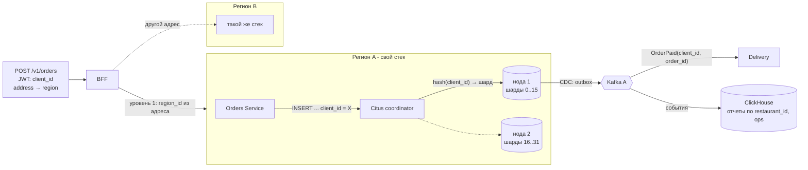

# ДЗ 3. Проектирование хранения данных — решение

> Условие: [../Задание.md](../Задание.md)
> Шаблоны: [сравнение БД](../Таблица%20сравнения%20БД%20с%20критериями%20выбора.md) ·
> [кэширование](../Чек-лист%20стратегий%20кэширования.md) ·
> [шардирование](../Шаблон%20схемы%20шардирования.md). Схемы — в [diagrams/](diagrams/).

> Выполняется для системы, выбранной в ДЗ 2.

## 1. Модель данных

> **ER-диаграмма** - Entity-Relationship Diagram графическая схема, которая наглядно показывает, какие данные есть в системе и как они связаны между собой.  
> **FK** (foreign key) - внешний ключ: поле, которое ссылается на строку другой таблицы в той же БД.  
> **PK** (primary key) - первичный ключ.  
> **UK** (unique key) - уникальное поле, которое не является PK.

### 1.1. Authentication Service - аккаунты и роли

Курьер может сам заказать еду. Если сделать тип пользователя (role) в ACCOUNT одним значением, то такой случай не описать.  
Альтернатива хранить роли списком, либо вообще убрать role из ACCOUNT и определять роли из наличия строк в CLIENT_PROFILE, COURIER и RESTAURANT_STAFF (но у такого решения будет минус - придется обращаться к другим сервисам).

Authentication Service определяет роли, используя собственную БД, в следующем порядке:

- пользователь вводит телефон и код OTP в приложении
- Authentication Service находит ACCOUNT по телефону и читает все строки ACCOUNT_ROLE этого аккаунта
- Authentication Service кладет список ролей в JWT, например roles: ["client", "courier"], подписывает токен и отдает приложению
- дальше BFF на каждом запросе смотрит роли в токене: эндпоинты курьера вроде accept оффера требуют courier, оформление заказа требует client. В Authentication Service при этом никто не ходит, подпись проверяется по открытому ключу.

Роли выдают разные сервисы в разные моменты, но записывает всегда Authentication Service:

- client выдается автоматически при первом входе по телефону в клиентском приложении
- courier выдается после онбординга в Delivery: когда курьер проверен и активирован, Delivery сообщает Authentication Service, что аккаунту нужно добавить роль. Удобно сделать это событием CourierActivated через Kafka, в том же стиле, что и остальные интеграции.
- restaurant выдает владелец заведения, приглашая сотрудника в панели ресторана. Catalog создает строку RESTAURANT_STAFF и просит Auth добавить роль.
- ops выдает администратор вручную

Что видит человек с двумя ролями. У клиента и курьера разные приложения. Войдя в курьерское приложение, он получает тот же токен с обеими ролями, но приложение использует курьерские эндпоинты. Если у аккаунта нет роли courier, Auth при входе в курьерское приложение отвечает, что нужно пройти онбординг, а не выдает токен. Для этого приложение при входе указывает, какую роль ему нужно.

Предполагается, что БД Authentication Service будет содержать следующие таблицы:

- **ACCOUNT**. Данные об аккаунтах и данных, необходимых для аутентификации;
- **ACCOUNT_ROLE**. Роли вынесены в отдельную таблицу `ACCOUNT_ROLE`, а не в поле `role` таблицы ACCOUNT: курьер может сам заказать еду, сотрудник ресторана - подрабатывать курьером;
- **REFRESH_TOKEN**. Хранит долгоживущую сессию, которую можно отозвать. Сам JWT для этого не подходит: в схеме он нигде не лежит, только проверяется по подписи и JWKS. Короткий JWT клиент предъявляет на каждый запрос. Когда он истекает, приложение присылает refresh-токен, и Auth по строке в этой таблице решает, выпускать ли новую пару. Без таблицы после истечения JWT пришлось бы снова проходить OTP или пароль.

> **OTP** (one-time password) - одноразовый код на телефон. С его помощью входят клиенты и курьеры: Auth кладет код в Redis (otp:{phone}) на 5 минут и ограничивает число попыток. После успешного ввода код больше не нужен.  
> **JWT** (JSON Web Token) - подписанный токен, который приложение прикладывает к следующим запросам. Внутри - кто это (account_id) и какие роли. Auth его нигде не хранит: BFF проверяет подпись и срок. Токен короткий, поэтому предусмотрен еще refresh-токен в таблице REFRESH_TOKEN: по нему выпускается новый JWT без повторного OTP.  
> **JWKS** (JSON Web Key Set) - набор публичных ключей. Ими проверяется подпись JWT. Сам ключ подписи остается у Authentication Service, публичная часть общая для всех регионов, чтобы токен, выданный в одном городе, принимали в другом.

### 1.2. Profile Service - клиент, адреса, платежные методы

Предполагается, что БД Profile Service будет содержать следующие таблицы:

- **CLIENT_PROFILE**. Профиль клиента: имя, контактный email, язык интерфейса. `home_region` указывает, какой регион владеет записью и имеет право ее менять; `version` нужен CDC-репликации, чтобы остальные регионы получали read-only копию и клиент в поездке видел свои адреса и карты;
- **ADDRESS**. Сохраненные адреса доставки пользователя. Кроме текста и координат хранит информацию для курьера (подъезд, этаж, квартира, домофон, комментарий), которые при заказе целиком копируются в `ORDER.address_details`. `is_default` - адрес, подставляемый по умолчанию;
- **PAYMENT_METHOD**. Способы оплаты. Номер карты не хранится: только `provider_token`, по которому Payment GW создает платеж без повторного ввода карты, и последние 4 цифры номера карты;
- **FAVORITE**. Избранные товары клиента. `menu_item_id` ссылается на Catalog только по значению, без FK между БД: если позицию удалили из меню, она отфильтровывается при отображении, а не каскадом в чужой БД.

Геокодирование адреса пользователя (адреса доставки) выполняется при сохранении, чтобы при заказе `ValidateAndQuote` и `QuoteFee` получали готовые координаты и гео-сервис не стоял в критическом пути заказа.

### 1.3. Catalog Service - рестораны, меню, промо

Адрес магазина (ресторана) и зона доставки хранятся здесь: адрес меняется редко, координаты вычисляются один раз через гео-сервис при подключении. Зона доставки - полигон PostGIS с GiST-индексом, по нему же `ValidateAndQuote` проверяет «адрес доставки в зоне». Поиск «рестораны в радиусе» идет по кэшу координат в Redis GEO (`restaurants:geo`), истина в PostgreSQL. Меню кэшируется целиком по ключу `menu:{restaurant_id}:{version}`. Фото блюд и логотипы хранятся в object storage, в БД хранится только ключ.

Предполагается, что БД Catalog Service будет содержать следующие таблицы:

- **BRAND**. Информация об организации (бренде), у одной организации может быть несколько (сеть) магазинов (ресторанов). Сеть может работать в нескольких регионах, поэтому это единственная таблица Catalog, которая реплицируется во все регионы как единый реестр (`version` для CDC);
- **RESTAURANT**. Информация о магазинах (ресторанах). Конкретная точка: адрес и координаты (геокодированы один раз при подключении), полигон зоны доставки (PostGIS), график работы и т.п. `pos_type` и `pos_external_id` - привязка к POS-системе заведения: по ним POS GW понимает, куда отправлять `SubmitOrder` и чей webhook пришел. `brand_id` nullable - одиночное заведение без сети;
- **RESTAURANT_STAFF**. Сотрудники ресторана и их права. `role` определяет, что можно делать: `owner` приглашает сотрудников и управляет точкой, `manager` правит меню и цены, `cook` - только стоп-лист и `is_open`;
- **MENU_CATEGORY**. Разделы меню («Пицца», «Напитки») для группировки и порядка показа (`sort_order`). Привязана к ресторану, а не к бренду: даже внутри сети у каждой точки может быть свое меню и свои цены;
- **MENU_ITEM**. Позиция меню: название, описание, цена, ключ фото в object storage, флаг доступности;
- **STOP_LIST**. Временно недоступные позиции - «закончилось сегодня»;
- **PROMO_CODE**. Промокоды: сам код, скидка, остаток применений и период действия. `scope` разделяет локальные промо, которые региональный маркетинг заводит на месте, и глобальные, которые приходят репликацией;
- **PROMO_RESERVATION**. Резерв промокода на время между checkout и оплатой. Без этой таблицы последний экземпляр промокода могли бы одновременно применить два клиента, или код зависал бы навсегда при обрыве между checkout и оплатой.

### 1.4. Orders Service - заказ и снимки

Предполагается, что БД Orders Service будет содержать следующие таблицы:

- **ORDER**. Заказ. Хранит, кто и у кого заказал, текущий `status`, снимок адреса доставки (текст, координаты, детали для курьера), суммы (позиции, скидка, тариф доставки, итог) и ссылку на резерв промокода. Имя ресторана и адрес - снимки, а не ссылки: если клиент потом переименует «Дом» или ресторан сменит название, история заказов не изменится;
- **ORDER_ITEM**. Состав заказа: что заказано и сколько. Название, цена и `price_version` скопированы из Catalog в момент `ValidateAndQuote`, `menu_item_id` - тот же `offer_id`, без FK между БД. Снимок нужен для чека, расчета возврата и разбора споров «я заказывал по другой цене», даже если позицию уже удалили из меню;
- **PAYMENT**. Информация о платеже;
- **ORDER_STATUS_HISTORY**. Журнал переходов статуса: какой статус, кто его инициировал (`source` - клиент, платежный webhook, POS, Delivery, оператор поддержки) и когда. В `ORDER.status` лежит только текущее значение; по истории считаются метрики SLA (сколько готовили, сколько везли), восстанавливается хронология при жалобе в Support и строится аналитика.

Таблица `PAYMENT` - ссылка на платеж у провайдера и его статус по webhook, чтобы Orders мог сопоставить `PaymentSucceeded` с заказом и инициировать возврат. `payment_deadline` закрывает заказы, по которым клиент так и не оплатил: по истечении заказ переводится в `cancelled`, резерв промо освобождается.

### 1.5. Delivery Service - курьеры, смены, доставки

Предполагается, что БД Delivery Service будет содержать следующие таблицы:

- **COURIER**. Профиль курьера: имя, тип транспорта (влияет на радиус геопоиска и тариф в `QuoteFee`), рейтинг и число выполненных доставок. `status` - жизненный цикл онбординга: переход в `active` порождает событие `CourierActivated`, по которому Auth добавляет аккаунту роль `courier`; `blocked` снимает курьера с линии без удаления истории. PK = `ACCOUNT.id`. `home_region` и `version` - запись реплицируется во все регионы, чтобы курьер мог выйти на смену в другом городе;
- **SHIFT**. Смена курьера: когда начал, когда закончил, в каком районе (`zone_id`). Открытая смена (`ended_at` IS NULL) - условие, при котором курьер вообще получает офферы; район смены ограничивает, какие доставки ему предлагать;
- **DELIVERY**. Доставка одного заказа. Создается событием `OrderPaid` в `waiting_kitchen`, по `KitchenReady` переходит в `offering`, после accept - в `assigned`, дальше отметки курьера `picked_up` и `delivered`. `courier_id` пуст до назначения. Точки забора и доставки - снимки из заказа, чтобы матчинг не ходил в Orders и Catalog. Временные отметки этапов нужны для ETA, выплат и SLA;
- **DELIVERY_OFFER**. Предложение конкретной доставки конкретному курьеру с дедлайном `expires_at`. У одной доставки несколько офферов: волны геопоиска, пока кто-то не примет. История нужна, чтобы не предлагать ту же доставку отказавшемуся повторно.

### 1.6. Tracking Service - только Redis

Реляционных таблиц нет: точка курьера живет минуты, писать ее в PostgreSQL бессмысленно. Структуры кэша (Redis):

| Ключ | Тип | Что хранит | Срок жизни |
| --- | --- | --- | --- |
| `couriers:online` | GEO (sorted set) | `courier_id` → lon, lat; читает Delivery для `GEOSEARCH` | у членов GEO нет TTL, чистится по `couriers:last_seen` |
| `couriers:last_seen` | sorted set | `courier_id` → unix time последней точки | фоновая задача удаляет из обоих наборов тех, кто молчит > 60 с |
| `courier:{id}:pos` | hash | lat, lon, heading, ts, `order_id` | TTL 60 с |
| `order:{id}:eta` | string | ETA в минутах от гео-сервиса | TTL 60–120 с, пересчет не на каждую точку |
| `order:{id}:track` | pub/sub канал | кадры `{lat, lon, eta_min, ts}` подписчикам | - |

История точек не хранится.

> ETA (estimated time of arrival) — оценка, через сколько минут курьер будет у клиента.

### 1.7. Support Service - обращения, оценки, звонки

Один объект «обращение по заказу» объединяет чат, жалобу и оценку, как решено в ДЗ 2. Непрочитанные сообщения и веерная рассылка (fan-out) по открытым сокетам - в Redis (`thread:{id}:unread:{account_id}`, pub/sub `thread:{id}`), текст в PostgreSQL. Вложения чата и записи звонков - в object storage.

Предполагается, что БД Support Service будет содержать следующие таблицы:

- **THREAD**. Обращение - один объект, объединяющий чат, жалобу, оценку и звонки по заказу. Идентификаторы заказа, клиента, курьера и ресторана - просто uuid без FK между БД;
- **MESSAGE**. Сообщения в треде: автор, текст и т.п.
- **RATING**. Оценка заказа клиентом: ресторану и курьеру отдельно, с комментарием. UK по `order_id` - одна оценка на заказ. `thread_id` nullable: оценка может быть и без переписки, а при жалобе связывается с тредом;
- **CALL**. Маскированный звонок через Telephony GW: `provider_call_id` - идентификатор у оператора телефонии, по нему сопоставляются webhook-и статусов; кто кому звонил (`from_account_id`, `to_account_id`) без реальных номеров; статус, длительность, ключ записи в object storage. Привязан к треду, чтобы звонок был виден в истории обращения вместе с сообщениями.

### 1.8. Сводка: кто чем владеет

| Сущности | Сервис | Хранилище | Область |
| --- | --- | --- | --- |
| ACCOUNT, ACCOUNT_ROLE, REFRESH_TOKEN | Auth | PostgreSQL (своя БД) | регион регистрации, JWKS общий |
| OTP, лимиты попыток | Auth | Redis | регион |
| CLIENT_PROFILE, ADDRESS, PAYMENT_METHOD, FAVORITE | Profile | PostgreSQL | домашний регион → все регионы read-only |
| BRAND | Catalog | PostgreSQL | единый реестр → все регионы |
| RESTAURANT, RESTAURANT_STAFF, MENU_*, STOP_LIST, PROMO_* | Catalog | PostgreSQL + PostGIS | регион |
| кэш меню, `restaurants:geo` | Catalog | Redis | регион |
| фото блюд, логотипы | Catalog | Object storage | регион |
| ORDER, ORDER_ITEM, PAYMENT, ORDER_STATUS_HISTORY | Orders | PostgreSQL | регион |
| COURIER | Delivery | PostgreSQL | регион регистрации → все регионы |
| SHIFT, DELIVERY, DELIVERY_OFFER | Delivery | PostgreSQL | регион |
| `couriers:online`, `courier:{id}:pos`, ETA, pub/sub | Tracking | Redis | регион |
| THREAD, MESSAGE, RATING, CALL | Support | PostgreSQL | регион |
| вложения, записи звонков | Support | Object storage | регион |
| `outbox`, `processed_events` | Orders, Delivery, Support | PostgreSQL, та же БД сервиса | регион |
| события, точки для аналитики | все → Analytics | ClickHouse (центр) | one-way поток |

Между БД разных сервисов внешних ключей нет: `client_id`, `restaurant_id`, `order_id` в чужих таблицах - просто uuid, целостность обеспечивается событиями и снимками, а не ограничениями СУБД.

## 2. Выбор БД

Исходные цифры из ДЗ 2 на одну агломерацию:

- 1M DAU
- до 30k заведений
- 20–30k курьеров одновременно на линии
- 1.5M заказов в сутки
- пик около 100 RPS заказов

Это не «хайлоад» на запись для реляционной БД: один заказ дает порядка десяти INSERT/UPDATE за весь жизненный цикл, то есть сотни операций записи в секунду в пике. При этом на checkout и на accept оффера нужны транзакции и условные UPDATE. Поэтому для транзакционных сервисов выбран PostgreSQL, а другие БД взяты там, где форма данных или нагрузка другие: геоданные курьеров, аналитика, медиа-файлы.

| Сервис | Что хранит | Форма данных | Ключевые запросы | Выбранная БД | Почему именно она |
| --- | --- | --- | --- | --- | --- |
| Auth | аккаунты, роли, refresh-токены | реляционная, 3 таблицы, уникальность телефона и email | точечно по телефону / email при входе, по `token_hash` при refresh | PostgreSQL (своя БД, отдельная от остальных) | уникальные индексы и транзакция «аккаунт + роль» при первом входе; отдельная БД, чтобы утечка или падение другого сервиса не задели учетные данные |
| Auth | OTP-коды, счетчики попыток, rate limit | ключ → значение с TTL | `GET`/`INCR` по `otp:{phone}` | Redis | код существует 5 минут; счетчики атомарны; PostgreSQL для этого пришлось бы чистить вручную |
| Profile | профиль, адреса, платежные методы, избранное | реляционная, один клиент → много адресов и карт | по `account_id` из JWT, редкие обновления | PostgreSQL + логическая репликация (CDC) в другие регионы | данные персональные и нужны для чека и возврата, важна точность; объем мал (2M клиентов × единицы адресов); CDC по WAL дает read-only копии в других регионах |
| Catalog | рестораны, зоны доставки, меню, стоп-листы, промокоды | реляционная + геометрия (полигоны зон) | «ресторан в радиусе», «точка в полигоне», меню ресторана целиком, атомарное `uses_left - 1` у промокода | PostgreSQL + PostGIS | GiST-индекс по полигону закрывает «адрес в зоне» в `ValidateAndQuote`; резерв промокода - транзакция с условием на остаток; 30k заведений × десятки позиций - единицы миллионов строк, один узел |
| Catalog | кэш меню, координаты ресторанов для поиска в радиусе | key-value, GEO-набор | `GET menu:{id}:{version}`, `GEOSEARCH restaurants:geo` | Redis | витрину смотрят чаще, чем заказывают; GEO-набор отвечает на радиус за миллисекунды и не загружает PostgreSQL просмотром. |
| Catalog | фото блюд, логотипы | бинарные объекты | отдача по ключу | Object storage (S3-совместимый, региональный) | миллионы картинок не место в СУБД; в таблице только ключ. CDN не нужен, трафик региональный для каждой агломерации (ДЗ 2) |
| Orders | заказы, позиции, платежи, история статусов | реляционная, агрегат «заказ» | по `id`, по `idempotency_key`, «мои заказы» по `client_id`, переходы статуса по условию | PostgreSQL | checkout фиксирует заказ, позиции и строку outbox одной транзакцией; `idempotency_key` UK и условные UPDATE статуса - именно то, что дает реляционная СУБД. Деньги считаются здесь, eventual consistency неприемлема |
| Delivery | курьеры, смены, доставки, офферы | реляционная, гонка за одну строку | условный `UPDATE ... WHERE status = 'offered'`, частичный уникальный индекс по `order_id` | PostgreSQL | решение «кто повез» принимает одна строка в одной БД: ноль обновленных строк - HTTP 409 «оффер уже принят». Никакого отдельного кода для гонки писать не нужно: атомарность условия и обновления дает сама СУБД. В документной или wide-column БД такой инвариант пришлось бы реализовывать "вручную" |
| Delivery | кэш офферов, что кому предложено | ключ → значение с TTL | по `offer_id` | Redis | оффер живет десятки секунд; результат в итоге - в PostgreSQL |
| Tracking | текущая точка курьера, ETA, поток точек клиенту | гео-точки с TTL, pub/sub | `GEOADD`/`GEOSEARCH`, `GET` ETA, подписка на канал заказа | Redis (только), без реляционной БД | 20–30k курьеров × точка каждые 3–5 с - 5–10k записей в секунду, каждая живет минуту. В PostgreSQL это был бы бесполезный WAL и vacuum; потеря одной точки терпима, поэтому persistence не нужен |
| Support | треды, сообщения, оценки, звонки | реляционная, тред → сообщения | по `thread_id` с сортировкой по времени, по `order_id` | PostgreSQL | история чата должна сохраниться для разбора жалоб; одна оценка на заказ - UK; объем умеренный (не каждый заказ приводит к появлению треда) |
| Support | непрочитанные, рассылка (fan-out) по сокетам | счетчики, pub/sub | `INCR thread:{id}:unread:{account_id}`, `PUBLISH thread:{id}` | Redis | счетчик и рассылка живым подключениям - не то, что хочется писать в журнал транзакций на каждое сообщение |
| Support | вложения, записи звонков | бинарные объекты | по ключу | Object storage | как у Catalog |
| Payment GW, POS GW, Telephony GW | дедупликация входящих webhook по `event_id` | ключ с TTL | `SET NX webhook:{provider}:{event_id}` | Redis | адаптеры без состояния; им нужно только помнить, что `event_id` уже видели, пару недель. Доменное состояние - у Orders / Delivery / Support |
| Notify | очередь на отправку, дедупликация | события | consumer group Kafka | без своей БД (Kafka + Redis для дедупликации) | шлюзы SMS/PUSH сами возвращают статус; журнал отправок уходит в ClickHouse, он нужен для аналитики, а не для транзакций |
| Sync | смещения CDC, версии реплицируемых сущностей | лог изменений | последовательное чтение WAL | без своей БД: Debezium (Kafka Connect) хранит offset в топиках Kafka | второй СУБД не нужно, состояние коннектора и так живет в Kafka |
| Analytics | события всех регионов, точки курьеров, журнал отправок | события append-only, агрегаты | «средняя длительность готовки по ресторанам за неделю», «acceptance rate по районам» и т.п. | ClickHouse (центр) | агрегаты по миллиардам строк - колоночная задача; в PostgreSQL такие запросы отнимали бы ресурсы у заказов. Загрузка one-way из Kafka, update не нужен |

## 3. Шардирование

### 3.0. Нужно ли шардировать?

Оценка для Orders одной агломерации:

| Показатель | Оценка | Откуда |
| --- | --- | --- |
| Заказов в сутки | 1.5M | ДЗ 2, «утро-обед-вечер» 0.5M × 3 |
| Запись в пике | ~100 заказов/с × ~10 строк (заказ, 2–4 позиции, платеж, 6 статусов, outbox) ≈ 1 000 строк/с | 100 RPS пик, модель данных п. 1.4 |
| Размер одного заказа со всеми строками | ~2.5 КБ | uuid, снимок адреса в `jsonb`, 3 позиции, история |
| Прирост | ~3.7 ГБ/сутки, ~1.4 ТБ/год | 1.5M × 2.5 КБ |
| Горячие данные | последние 90 дней ≈ 340 ГБ | ops и Support смотрят недавние заказы, старое - в ClickHouse |

Тысяча строк в секунду и сотни гигабайт горячих данных - рабочий режим одной PostgreSQL на NVMe с синхронной репликой и 1–2 репликами для чтения. Ответ по рекомендуемому шаблону: **внутри региона шардирование Orders не требуется**. Но шардирование по регионам уже есть, оно принято в ДЗ 2, и именно его надо описать как уровень 1; а ключ для уровня 2 стоит выбрать сейчас, потому что он влияет на то, как писать запросы, и менять его потом дорого.

### 3.1. Уровень 1: geo-шардирование по агломерации (уже есть)

Ключ - `region_id`, он вычисляется из адреса доставки на BFF и дальше запрос целиком живет в стеке региона. Это стратегия «Geo / по атрибуту» из шаблона.

- **Равномерность.** Перекос между регионами есть и большой: самая крупная агломерация в разы больше остальных. Это терпимо, потому что регион - не кусок одной БД, а отдельный стек, который масштабируется независимо. Маленькие регионы можно разворачивать на "общем" железе.
- **Локальность.** Заказ, ресторан, курьер и кухня в одной агломерации, границы не пересекаются (ДЗ 2). Cross-shard запросов в пути заказа нет вообще.
- **Рост.** Новая агломерация - новый стек, данные никуда не переезжают. Ребалансировки нет по построению.
- **Транзакции.** Все транзакции checkout и accept внутри одного региона, SAGA из ДЗ 2 не пересекает границу шардов.
- **Что пересекает границу.** Только глобальные сущности (профиль, курьер, бренд, глобальные промо) - они реплицируются CDC через хаб, а не запрашиваются по сети. Клиент в чужом городе читает локальную read-only копию своего профиля.

### 3.2. Уровень 2: Orders внутри региона, когда одна нода перестанет вмещать

Триггер перехода: 90 дней не влезают в память и кэш страниц, либо запись упирается в один WAL. 

| Кандидат в ключи | Равномерность | Локальность запросов | Риск hotspot | Вывод |
| --- | --- | --- | --- | --- |
| `order_id` (uuid) | идеальная | «мои заказы» клиента размазываются по всем шардам; `idempotency_key` тоже глобальный | нет | плохо: самый частый запрос клиента становится scatter-gather |
| `client_id` | высокая: 2M клиентов, у каждого единицы заказов в день | «мои заказы», повтор по `idempotency_key` (ключ выдает клиент), история для Support - все в одном шарде | низкий: нет клиента с тысячами заказов | **подходит** |
| `restaurant_id` | плохая: сеть с сотней точек и дарк-китчены дают перекос | панель ресторана локальна, но клиентские запросы - scatter | высокий: популярная точка в обед | нет |
| `created_at` (range) | нет: вся запись идет в свежий диапазон | хорошо для архива и отчетов | максимальный: один «текущий» шард принимает все | нет как ключ шардирования, да как партиционирование внутри шарда |

> **Scatter-gather** - это запрос клиента, который нельзя направить в один шард, поэтому его приходится "разбросать" (scatter) по всем шардам и потом "собрать" (gather) результаты. Допустим, Orders разрезан на 4 шарда по order_id. Каждый заказ попадает в шард по хэшу своего идентификатора, и заказы одного клиента оказываются размазаны по всем четырем. Клиент открывает экран «Мои заказы». Сервис знает только client_id, а по нему нельзя вычислить, в каком шарде лежат заказы. Остается одно: отправить SELECT ... WHERE client_id = X во все четыре шарда, дождаться четырех ответов, слить их, отсортировать по дате и отдать клиенту.

Итог для Orders:

| Что шардируем | Ключ | Стратегия | Кол-во шардов (старт) | Ребалансировка | Главный риск + как лечим |
| --- | --- | --- | --- | --- | --- |
| ORDER, ORDER_ITEM, PAYMENT, ORDER_STATUS_HISTORY, outbox - колокация по `client_id` | `client_id` | hash, через Citus (распределенные таблицы с `distribution column = client_id`) | 4 логических шарда на 2 нодах, Citus держит 32 физических шарда и переносит их целиком при добавлении нод | добавление ноды - перенос части из 32 шардов без изменения хэш-функции (pre-splitting); онлайн, с копированием и короткой блокировкой на переключение | запросы без `client_id` (панель ресторана «мои заказы за сегодня», ops «все застрявшие в `cooking`») становятся scatter-gather - уводим их в ClickHouse и в реплику с материализованным срезом по `restaurant_id`; Delivery ищет заказ по `order_id` - он несет `client_id` в событии `OrderPaid`, по паре `(client_id, order_id)` запрос идет в один шард |

> **Citus** - это расширение PostgreSQL, которое превращает несколько обычных инстансов PostgreSQL в один шардированный кластер.

`ORDER.id` остается глобально уникальным uuid, поэтому ссылка `DELIVERY.order_id` и `RATING.order_id` в других сервисах не меняется. Внутри каждого шарда таблицы партиционируются по `created_at` помесячно: это не шардирование, а способ дешево отрезать старые месяцы (`DETACH PARTITION`) после выгрузки в ClickHouse.

Распределенных транзакций не появляется: все строки одного заказа лежат в одном шарде, потому что у ORDER_ITEM, PAYMENT и ORDER_STATUS_HISTORY `client_id` добавляется как колонка распределения. Единственная транзакция, пересекающая сервисы, уже решена SAGA в ДЗ 2. Уникальный индекс по `idempotency_key` остается локальным на шард, и этого достаточно: ключ выдает клиент, а все заказы клиента в одном шарде.

Типовые запросы на схеме: «мои заказы» и повтор checkout по `idempotency_key` - один шард по `client_id`; Delivery и Support приходят с `(client_id, order_id)` из события - один шард; отчет ресторана и сводка ops - ClickHouse, не PostgreSQL.

### 3.3. Tracking: Redis, ключ `courier_id`, горячий ключ дробится по району

Здесь шардирование может понадобиться раньше, чем в Orders, потому что нагрузка другая: 20–30k курьеров × точка каждые 3–5 с = 5–10k точек в секунду, каждая точка - три команды (`GEOADD`, `HSET`, `ZADD`), итого 15–30k операций в секунду. Один инстанс Redis на это способен, но запас по пику двойной, а не десятикратный, и один процесс - одна точка отказа для всего трекинга региона. Берем Redis Cluster (3 master + 3 replica).

| Кандидат в ключи | Равномерность | Локальность запросов | Риск hotspot | Вывод |
| --- | --- | --- | --- | --- |
| `courier_id` в `courier:{id}:pos` | идеальная, Redis Cluster сам раскладывает по 16384 хэш-слотам | запись точки и чтение позиции одного курьера - один слот | нет | **подходит** для hash и позиции |
| один ключ `couriers:online` на регион | нет: один ключ = один мастер, кластер не помогает | `GEOSEARCH` - один вызов | весь GEO-трафик региона на одной ноде | плохо, дробим |
| `couriers:online:{zone_id}` | хорошо: районов десятки, каждый на своем слоте | `GEOSEARCH` при матчинге и так делается вокруг ресторана, то есть внутри района; Delivery знает `zone_id` ресторана | район-центр крупнее окраины, но это разница в разы, не в сотни раз | **подходит** для GEO-набора |
| `order:{id}:track` pub/sub | по `order_id` | подписчик - один клиент | нет | подходит, но нужен sharded pub/sub (Redis, `SSUBSCRIBE`), иначе классический pub/sub рассылает на все ноды кластера |

Итог для Tracking:

| Что шардируем | Ключ | Стратегия | Кол-во шардов (старт) | Ребалансировка | Главный риск + как лечим |
| --- | --- | --- | --- | --- | --- |
| `courier:{id}:pos`, `couriers:last_seen` | `courier_id` | hash-слоты Redis Cluster | 3 мастера | штатная миграция слотов кластера, без простоя | - |
| `couriers:online` | `zone_id` ресторана / смены | по атрибуту: один GEO-набор на район | десятки наборов, раскладываются по тем же 3 мастерам | при добавлении мастера наборы переезжают вместе со слотами | ресторан у границы района: `GEOSEARCH` делается в своем районе и в соседних (Delivery знает список соседей), объединение на стороне сервиса |
| `order:{id}:track` | `order_id` | sharded pub/sub | те же 3 мастера | - | при падении мастера подписчики переподключаются через BFF и теряют 1–2 кадра, это допустимо |

В п. 1.6 GEO-набор показан одним ключом `couriers:online`; при переходе на кластер он становится семейством `couriers:online:{zone_id}`, Delivery при `GEOSEARCH` подставляет район ресторана.

Cross-shard запросов здесь два: `GEOSEARCH` по соседним районам у границы (2–3 вызова вместо одного) и фоновая чистка «молчит > 60 с» - она идет по `couriers:last_seen` каждого слота, это обычный `ZRANGEBYSCORE` на каждом мастере. Распределенных транзакций нет: точка курьера не нуждается в атомарности с чем-либо.

## 4. Кэширование

Кэшируем то, что читают на порядки чаще, чем пишут, и где отставание на секунды-минуты никому не вредит. Витрина - главный кандидат: по оценке ДЗ 2 просмотр каталога и трекинг дают примерно ×10 к RPS заказов. Что меняется на каждом шаге заказа - статус, остаток промокода, назначение курьера - не кэшируем: там отставание стоит денег или дает двойное назначение.

| Что кэшируем | Уровень | Стратегия | TTL | Инвалидация | Зачем |
| --- | --- | --- | --- | --- | --- |
| Меню ресторана целиком (категории, позиции, цены, стоп-лист) | Redis (app), ключ `menu:{restaurant_id}:{version}` | cache-aside: Catalog читает Redis, при промахе собирает из PostgreSQL и кладет | 10 мин | по событию: любое изменение меню или стоп-листа увеличивает `version` ресторана в PostgreSQL, старый ключ просто перестает запрашиваться и истекает по TTL. Клиенту отдается `ETag = version` | клиент открывает меню в разы чаще, чем заказывает; один JOIN из четырех таблиц на 30k заведений × 1M DAU - это нагрузка, которую снимаем с PostgreSQL |
| Координаты ресторанов для «в радиусе 10 км» | Redis GEO `restaurants:geo` | write-through: Catalog при изменении адреса или `is_open` пишет в PostgreSQL и в GEO-набор в одном коде; открытые и закрытые - отдельные наборы | без TTL | по событию (`RestaurantUpdated`), плюс полная пересборка из PostgreSQL раз в сутки и после рестарта Redis | `GEOSEARCH` за миллисекунды вместо `ST_DWithin` по 30k строк на каждый открытый экран |
| Карточка ресторана (название, рейтинг, график, `is_open`, лого) | Redis (app), `restaurant:{id}` | cache-aside | 5 мин | по событию `RestaurantUpdated`; `is_open` меняется через панель ресторана и сбрасывает ключ сразу | список «рестораны рядом» собирается из GEO-набора + N карточек, без обращения в PostgreSQL |
| Фото блюд, логотипы | клиент (HTTP-кэш) + object storage | ключ объекта содержит хэш содержимого, `Cache-Control: max-age=30d, immutable` | 30 дней | не нужна: новое фото - новый ключ | картинки - основной трафик витрины; CDN не нужен, object storage региональный (ДЗ 2) |
| JWKS (публичные ключи для проверки JWT) | в памяти процесса BFF и сервисов | read-through с фоновым обновлением | 1 ч | ротация ключа: новый ключ публикуется заранее, старый остается в наборе еще на TTL токенов | проверка подписи на каждый запрос без обращения в Auth |
| Расчет тарифа `QuoteFee(restaurant_id, zone_id)` | Redis (app) | cache-aside, ключ по ресторану и району адреса с округлением координат до ~100 м | 60 с | по TTL; пиковый коэффициент меняется раз в минуты | клиент видит стоимость доставки при каждом изменении корзины и адреса, это 5–7 одинаковых расчетов на один заказ; расчет требует дистанции и пиковый коэффициент |
| ETA заказа | Redis `order:{id}:eta` | write-behind от Tracking: пересчет через гео-сервис не на каждую точку, а не чаще раза в минуту | 60–120 с | по TTL | внешний гео-сервис платный и медленный; клиенту достаточно ETA с точностью до минуты |
| Текущая позиция курьера | Redis `courier:{id}:pos`, `couriers:online:{zone}` | это не кэш, а основное хранилище (п. 1.6), истины в PostgreSQL нет | 60 с | по TTL и чистке «молчит > 60 с» | упомянуто для полноты: TTL здесь задает, когда курьер считается пропавшим |
| Непрочитанные в чате | Redis `thread:{id}:unread:{account_id}` | write-through: `INCR` при сообщении, `DEL` при чтении | без TTL | по действию пользователя | счетчик на бейдже читается при каждом открытии приложения |
| Профиль и адреса клиента | не кэшируем | - | - | - | читается один раз на checkout по PK, PostgreSQL отдает за миллисекунды; а устаревший адрес - это заказ не туда |
| Статус заказа | не кэшируем | - | - | - | меняется каждые минуты, клиент получает изменения push-ем по WSS; stale-статус в кэше хуже одного `SELECT` по PK |
| Промокод и `uses_left` | не кэшируем | - | - | - | остаток применений уменьшается атомарно в транзакции резерва; кэш дал бы два применения последнего кода |
| «Мои заказы» | не кэшируем | - | - | - | индекс по `(client_id, created_at DESC)`, единицы строк на клиента; инвалидировать пришлось бы на каждую смену статуса |

Проблемы, которые надо адресовать (из чек-листа):

- **Cache stampede.** Меню популярного ресторана истекает в условный "обед", и тысяча клиентов одновременно обращаются к PostgreSQL. Механизм парирования - двойной: single-flight на ключ (`SET menu:{id}:lock NX EX 5`, остальные ждут 50–100 мс и перечитывают кэш) и early recompute: если до истечения осталось меньше 10 % TTL, первый читатель обновляет ключ в фоне, остальные получают старое значение. Для `restaurants:geo` проблемы нет: набор не истекает.
- **Cold start.** После рестарта Redis `restaurants:geo` пересобирается из PostgreSQL за секунды (30k строк) до того, как инстанс объявляется готовым. Меню не прогреваем: оно наполняется по запросам, в первые минуты PostgreSQL выдерживает промахи, а stampede ограничен single-flight. Трекинг после рестарта пуст и наполняется за 5 с - следующей точкой от каждого курьера.
- **Консистентность.** Меню может отставать от PostgreSQL до 10 мин, но стоп-лист и цена проверяются в `ValidateAndQuote` по PostgreSQL, поэтому клиент максимум увидит HTTP 422 «позиция недоступна» на checkout, а не закажет по старой цене. То же с `is_open`: витрина может показать закрытый ресторан, заказ в него не пройдет.
- **Вытеснение и память.** Два Redis-инстанса (кластера) на регион с разной политикой: *кэш* (`allkeys-lru`, вытеснение допустимо: меню, карточки, тарифы, ETA) и *состояние* (`noeviction`, persistence AOF: OTP, трекинг, офферы, счетчики непрочитанных, дедупликация webhook). Смешивать нельзя: LRU мог бы вытеснить OTP-код под нагрузкой на меню. Оценка памяти кэша: 30k меню × ~50 КБ = 1.5 ГБ, карточки и GEO - сотни МБ; состояние: 30k × 3 ключа × ~200 Б - десятки МБ.

> **Stampede** (cache stampede, thundering herd) - ситуация, когда ключа в кэше нет, а запросов на него приходит много одновременно. Все они промахиваются и все идут в PostgreSQL за одним и тем же меню. База делает сотни одинаковых тяжелых запросов вместо одного, а каждый из них еще и кладет в кэш одно и то же значение. Так бывает в двух случаях: ключ истек по TTL у популярного ресторана в обед, или Redis только что перезапустился и пуст вообще.  
> **Single-flight** - прием, когда на один ключ в полете разрешен ровно один запрос к источнику. Первый промахнувшийся ставит в Redis короткую блокировку:  
> `SET menu:{id}:lock NX EX 5`  
> NX означает «только если ключа еще нет», поэтому блокировку получит один процесс. Он идет в PostgreSQL, собирает меню, пишет его в кэш и снимает блокировку. Остальные, кому SET NX не удался, не идут в базу, а ждут 50–100 мс и перечитывают кэш, где значение уже есть. EX 5 - страховка: если держатель блокировки упал, через 5 секунд она исчезнет сама и следующий возьмет работу на себя.

## 5. Очереди

Брокер нужен там, где ответ ждет человека, кухню или внешнего провайдера, а запрос клиента к этому моменту уже закрыт (ДЗ 2, раздел 5). Внутри региона один кластер Kafka, между регионом и хабом - та же Kafka через Sync Service.

### 5.1. Почему Kafka, а не RabbitMQ или очередь в PostgreSQL

| Требование | Kafka | RabbitMQ | Очередь в таблице PostgreSQL |
| --- | --- | --- | --- |
| Несколько независимых потребителей одного события (`OrderPaid` читают Delivery, POS GW, Notify, Analytics) | consumer groups, каждая читает со своего смещения | нужен fan-out exchange и очередь на потребителя, сообщение копируется | каждый потребитель должен вести свой курсор, при трех-четырех потребителях таблица превращается в брокер |
| Порядок событий одного заказа (`paid` раньше `cooking`) | гарантирован внутри партиции при ключе `order_id` | только в одной очереди с одним потребителем | `ORDER BY`, но с блокировками при конкурентных воркерах |
| Повторное чтение: новый потребитель, пересчет аналитики, восстановление после бага | retention в днях, replay с любого смещения | сообщение удалено после ack | возможно, но таблица растет |
| CDC: transactional outbox и репликация регион ↔ хаб | Debezium пишет в Kafka напрямую, offsets в Kafka | через Kafka Connect все равно нужен Kafka | - |
| Нагрузка | тысячи событий в секунду в пике на регион - малая доля возможностей | тоже справится | справится, но нагружает основную БД |

Kafka выбран не из-за объема, а из-за трех вещей: несколько потребителей на событие, порядок по ключу и replay. Эти же свойства нужны потоку в ClickHouse и Sync Service, то есть брокер один на все задачи.

### 5.2. Топики региона

| Топик | Ключ партиции | Продюсер | Потребители | Зачем асинхронно |
| --- | --- | --- | --- | --- |
| `orders` (`OrderCreated`, `OrderPaid`, `OrderCancelled`, `OrderDelivered`) | `order_id` | Orders через outbox + CDC | Delivery, POS GW, Notify, Analytics | после оплаты заказ затрагивает кухню, курьера и уведомления; держать HTTP клиента нельзя, а порядок статусов одного заказа важен |
| `payments` (`PaymentSucceeded`, `PaymentFailed`, `RefundDone`) | `order_id` | Payment GW из webhook | Orders | 3-D Secure и СБП занимают секунды-минуты; webhook приходит, когда `POST /v1/orders` давно закрыт |
| `kitchen` (`KitchenSubmitted`, `KitchenRejected`, `KitchenReady`) | `order_id` | POS GW из webhook POS | Orders, Delivery, Notify | лежачая POS одного ресторана не должна останавливать остальных: у POS GW свой retry-топик и DLQ |
| `delivery` (`CourierAssigned`, `PickedUp`, `Delivered`, `CourierCancelled`) | `order_id` | Delivery через outbox | Orders, Notify, Analytics | оффер висит десятки секунд; Orders узнает о назначении из события, а не из ответа |
| `couriers` (`CourierActivated`, `CourierBlocked`) | `courier_id` | Delivery | Auth (роль `courier`), Sync | онбординг и роли - разные сервисы с разными БД |
| `catalog` (`MenuUpdated`, `StopListChanged`, `RestaurantUpdated`) | `restaurant_id` | Catalog | Catalog-кэш, POS GW (обратная синхронизация), Analytics | инвалидация кэша и синхронизация с POS не должны блокировать панель ресторана |
| `notifications` (`SendSms`, `SendPush`, `SendEmail`) | `account_id` | Auth (OTP), Orders, Delivery, Support | Notify | шлюзы SMS и PUSH медленные и с квотами; отказ SMS не откатывает заказ |
| `support` (`MessageSent`, `ThreadAssigned`) | `thread_id` | Support через outbox | Notify (получатель офлайн), Analytics | PUSH необязателен: сообщение уже в PostgreSQL |
| `cdc.*` (строки outbox и реплицируемых таблиц) | PK таблицы | Debezium из WAL PostgreSQL | роутер outbox → доменные топики; Sync Service → хаб | единый механизм «записал в БД - событие ушло» без двойной записи |

Ключ партиции - `order_id` почти везде. Все события одного заказа попадают в одну партицию и читаются одним потребителем по порядку, а разные заказы распределяются равномерно (uuid). Партиций на старте 12 на топик: это больше, чем инстансов любого потребителя, и позволяет масштабировать потребителей без перепартиционирования. Retention 7 дней для доменных топиков, чтобы пережить выходные с лежащим потребителем и дать replay; `cdc.*` - 3 дня.

### 5.3. Гарантии доставки

- **At-least-once + идемпотентность**, не exactly-once. Продюсер - Debezium с `acks=all` и `min.insync.replicas=2`, событие не теряется после коммита транзакции в PostgreSQL. Потребитель может получить дубль при ребалансе группы, поэтому каждый пишет `processed_events(event_id)` в той же транзакции, что и свое изменение (ДЗ 2). Повтор `OrderPaid` упирается в частичный уникальный индекс `deliveries(order_id)`.
- **Transactional outbox** в Orders, Delivery, Support: событие - строка в таблице `outbox` той же транзакции, что и доменное изменение; Debezium читает WAL, роутер раскладывает по топикам. Процесс может упасть между коммитом и публикацией - строку заберет CDC.
- **DLQ** только у адаптеров внешних систем (POS GW, Notify, Payment GW): после N попыток с backoff сообщение уходит в `*.dlq`, ops видит его в панели и может повторить вручную. У доменных потребителей (Orders, Delivery) DLQ нет: ошибка обработки `PaymentSucceeded` - это баг, который надо чинить, а не откладывать; потребитель останавливает партицию и поднимает алерт.
- **Ordering.** Один заказ - одна партиция - один потребитель. Между заказами порядок не нужен.

> **DLQ** - Это отдельный топик, куда потребитель откладывает сообщение, которое не смог обработать после нескольких попыток, чтобы не блокировать остальные и не потерять его. Потребитель Kafka читает партицию по порядку. Если сообщение не обрабатывается, у него два плохих варианта: пропустить и потерять, или повторять бесконечно, и тогда все сообщения за ним стоят. DLQ дает третий: после N попыток с нарастающей паузой переложить сообщение в *.dlq, зафиксировать смещение и идти дальше. Сообщение не потеряно, его видно, его можно разобрать и повторить руками.

### 5.4. Где брокер не нужен

- `ValidateAndQuote`, `QuoteFee` на checkout и accept оффера - синхронные gRPC: клиенту нужен ответ сейчас, а решение принимает одна строка в PostgreSQL.
- Трекинг - Redis pub/sub, не Kafka: тысячи кадров в секунду, каждый нужен одному подписчику на 3–5 с, replay и ретеншн вредны. В Kafka уходит только разреженная выборка точек для аналитики (раз в 30 с на курьера).
- Чат онлайн - Redis pub/sub по той же причине; Kafka только для PUSH офлайновому получателю.
- Синхронизация регион ↔ хаб - не отдельная очередь, а те же `cdc.*` топики, которые Sync Service фильтрует и пересылает.

> **Ретеншн** (retention, удержание) - это срок, в течение которого Kafka хранит сообщения на диске после того, как их записали. В разделе 5.2 он задан как 7 дней для доменных топиков и 3 дня для cdc.*.

## 6. CAP trade-offs

CAP выбирается не для системы целиком, а для каждого типа данных и для каждой границы, где возможен разрыв сети. В этой архитектуре таких границ две: внутри региона (между нодами PostgreSQL, Redis, Kafka) и между регионом и хабом.

### 6.1. Внутри региона: CP там, где деньги и инварианты

Деньги (транзакции) - данные, где расхождение стоит реальных денег: заказ и его сумма, факт оплаты, остаток применений промокода. Выбираем Consistency + Partition tolerance

| Данные | Хранилище | Выбор | Что происходит при partition | Почему так |
| --- | --- | --- | --- | --- |
| Заказ, суммы, резерв промокода | PostgreSQL Orders, Catalog | **CP**: один primary, синхронная реплика (`synchronous_commit = on`), автофейловер через Patroni | если primary отрезан от реплики - запись останавливается на время фейловера (десятки секунд), клиент получает 503 на checkout. Уже созданные заказы не теряются | лучше 30 секунд без новых заказов, чем два заказа с одним промокодом или потерянная оплата при переключении |
| Назначение курьера | PostgreSQL Delivery | **CP**: условный `UPDATE` на одном primary | при фейловере accept возвращает ошибку, курьер повторяет через несколько секунд | два курьера на один заказ - худший сценарий, чем задержка accept |
| Аккаунты, refresh-токены | PostgreSQL Auth | **CP** | вход и refresh недоступны на время фейловера; уже выданные JWT продолжают работать по JWKS | JWT делает Auth не критичным для текущих сессий |
| События (outbox → Kafka) | Kafka, `acks=all`, `min.insync.replicas=2`, RF=3 | **CP** для записи | при потере кворума продюсер (Debezium) ждет, события копятся в WAL PostgreSQL, ничего не теряется, доставка откладывается | потеря `OrderPaid` означает неприготовленный оплаченный заказ |
| Кэш меню, карточки, тарифы | Redis-кэш | **AP**, фактически «без C»: отставание до TTL | Redis недоступен - читаем PostgreSQL напрямую (деградация по латентности), витрина живет | stale-меню исправляется на checkout проверкой по PostgreSQL |
| Точки курьеров, ETA | Redis-состояние | **AP**: асинхронная репликация в кластере | при фейловере мастера теряются последние секунды точек; курьер пропадает с карты на 5 с до следующей точки | точка живет минуту, терять ее дешевле, чем ждать подтверждения реплики на каждую |
| OTP, дедупликация webhook | Redis-состояние, AOF | **AP** с оговоркой | при потере мастера клиент запросит код заново; повторный webhook может быть обработан дважды - его ловит `processed_events` в PostgreSQL | вторая линия защиты в CP-хранилище, поэтому первая может быть AP |

Заказ - целиком CP. При 100 RPS заказов цена простоя в 30 секунд - несколько тысяч клиентов, которые нажмут «повторить», а цена несогласованности - реальные деньги и двойные доставки.  
Все, что вокруг пути заказа (витрина, трекинг, чат), сделано AP и переживает падение любого компонента деградацией, а не отказом.

### 6.2. Между регионами: AP, консистентность eventual через CDC

| Данные | Направление | Выбор | Что видит пользователь при разрыве регион ↔ хаб |
| --- | --- | --- | --- |
| Профиль, адреса, карты | домашний регион → все | **AP**, свежесть минуты | клиент в чужом городе видит адреса на момент последней синхронизации; новый адрес, добавленный дома час назад, может не появиться. Заказ оформляется по локальной копии, снимок адреса в заказе все равно есть |
| Аккаунты курьеров | регион регистрации → все | **AP**, часы | курьер не сможет выйти на смену в чужом городе, если его только что активировали; дома - без ограничений |
| Бренды, глобальные промо | центр → все | **AP**, минуты | новый глобальный промокод появится в регионе с задержкой; локальные промо не зависят от хаба |
| Антифрод, черные списки | центр → все | **AP**, но ≤ 1 мин, с алертом при отставании | при долгом разрыве регион работает по последнему списку; риск принять заказ от только что заблокированного - принятый |
| JWKS | Auth → все | **AP**, ключи публикуются заранее | токены, выданные в другом регионе, проверяются по кэшированному набору ключей; ротация откладывается до восстановления связи |
| Аналитика | все → центр | **AP**, one-way | ClickHouse отстает; Kafka региона держит события 7 дней, после восстановления поток догоняет |

Разрыв с хабом не останавливает ни один регион: заказы, кухня, курьеры и витрина локальны по построению (ДЗ 2). Это главный выигрыш от geo-шардирования с точки зрения CAP: самая дорогая partition - между городами - не затрагивает CP-данные вообще, потому что CP-данные не пересекают границу.

### 6.3. PACELC: что мы отдаем в отсутствие partition

CAP говорит только о поведении при разрыве. В нормальном режиме выбор другой: латентность против консистентности (PACELC, «else latency or consistency»).

- **Orders, Delivery: EC.** Синхронная реплика добавляет единицы миллисекунд к каждому коммиту. Для 100 RPS это незаметно, зато фейловер без потери подтвержденных заказов.
- **Витрина: EL.** Меню читается из Redis и может отставать на 10 минут. Клиент получает ответ за миллисекунды, а расхождение ловится на checkout.
- **Трекинг: EL.** Redis без ожидания реплики; точка у клиента через 3–5 с после курьера, что и требуется.
- **Репликация между регионами: EL.** Профиль в чужом городе отстает на минуты, но checkout не ходит в домашний регион по сети. Альтернатива - синхронный запрос домой на каждый заказ в поездке - дала бы консистентность ценой зависимости пути заказа от межрегиональной сети, что противоречит п. 6.2.

> Фейловер (failover) - автоматическое переключение на резервный сервер, когда основной вышел из строя.

Единственное место, где латентность сознательно принесена в жертву консистентности, - путь заказа. Везде остальное наоборот, и граница между ними проходит ровно там, где заканчиваются финансы и начинается витрина.
