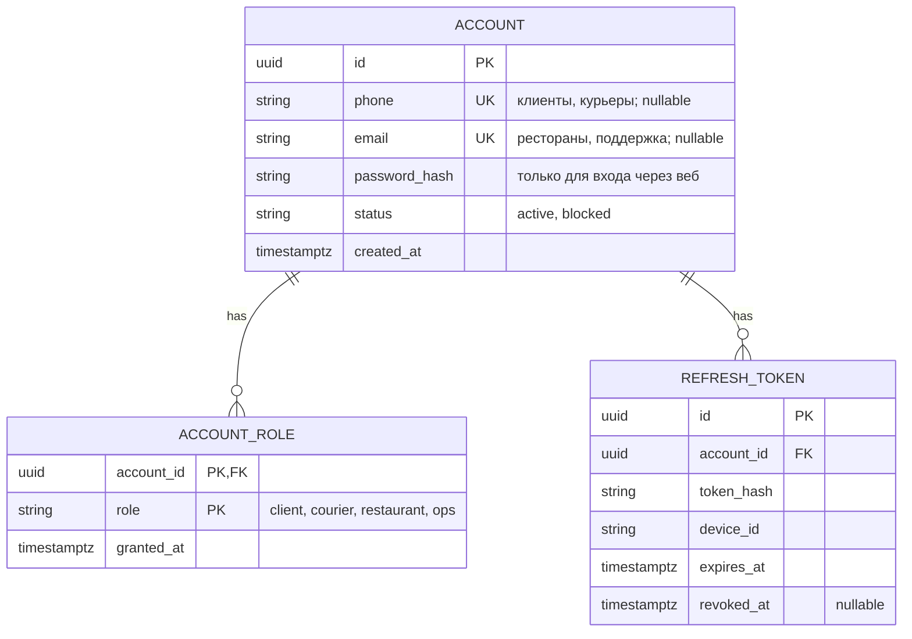
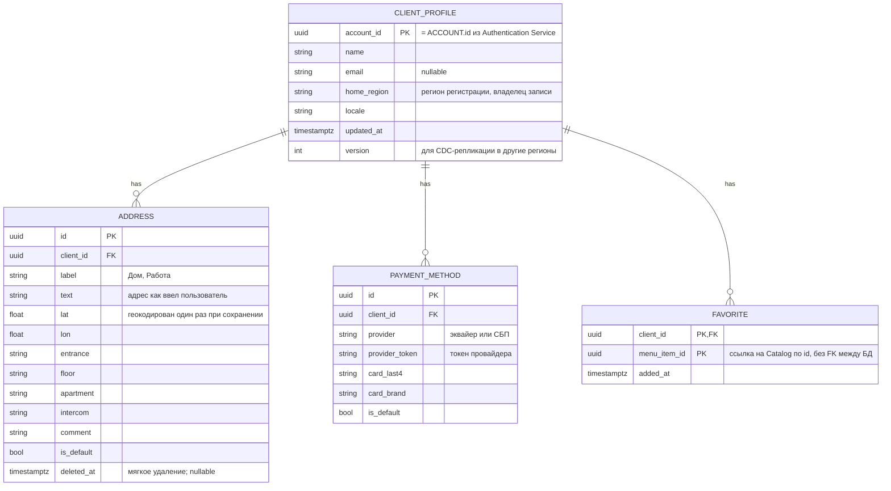
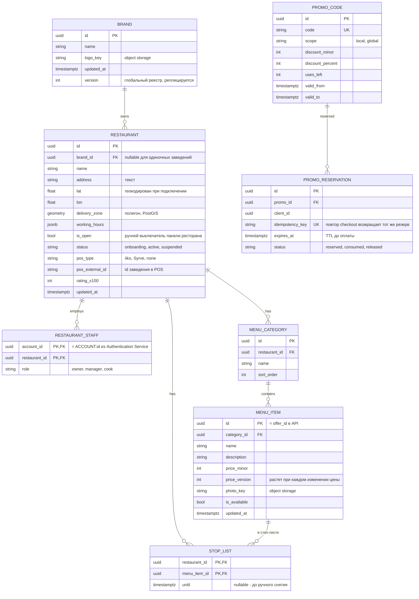
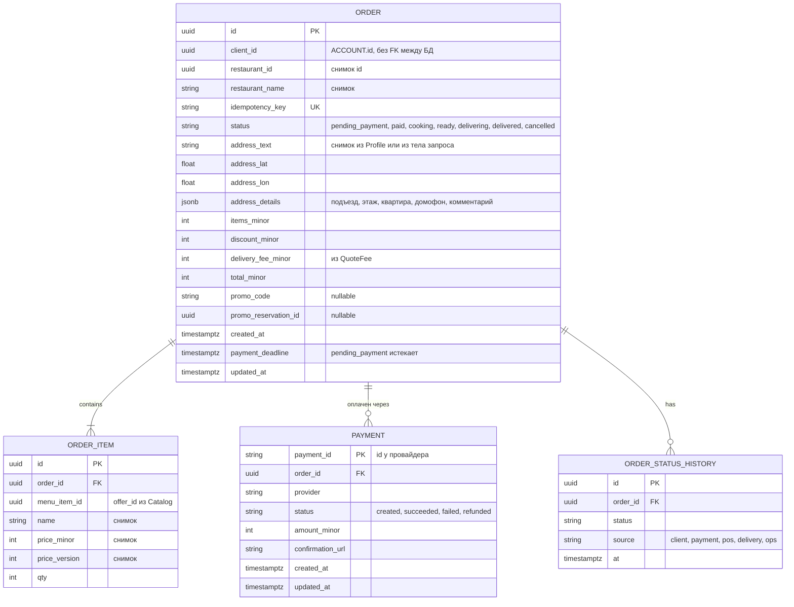
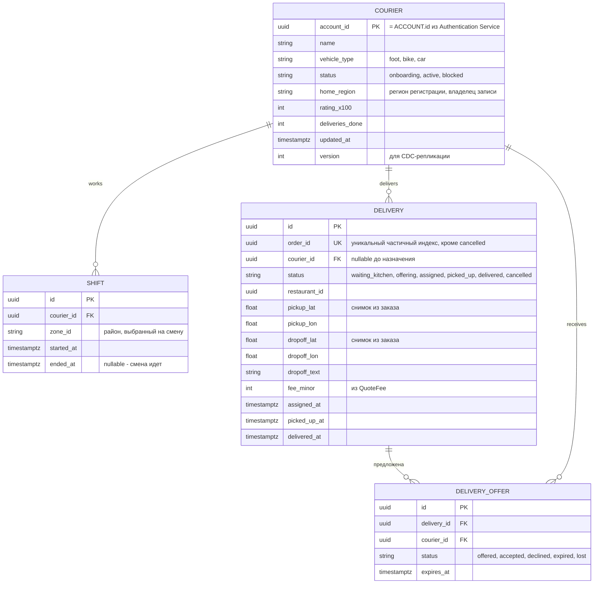
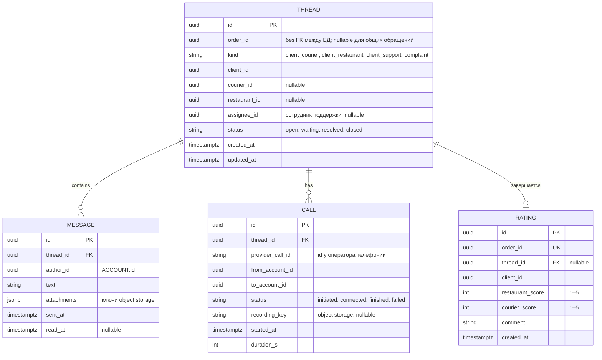

# ДЗ 3. Проектирование хранения данных — решение

> Условие: [../Задание.md](../Задание.md)
> Шаблоны: [сравнение БД](../Таблица%20сравнения%20БД%20с%20критериями%20выбора.md) ·
> [кэширование](../Чек-лист%20стратегий%20кэширования.md) ·
> [шардирование](../Шаблон%20схемы%20шардирования.md). Схемы — в [diagrams/](diagrams/).

> Выполняется для системы, выбранной в ДЗ 2.

## 1. Модель данных

> **ER-диаграмма** - Entity-Relationship Diagram графическая схема, которая наглядно показывает, какие данные есть в системе и как они связаны между собой.  
> **FK** (foreign key) - внешний ключ: поле, которое ссылается на строку другой таблицы в той же БД.  
> **PK** (primary key) - первичный ключ.  
> **UK** (unique key) - уникальное поле, которое не является PK.

### 1.1. Authentication Service - аккаунты и роли

Курьер может сам заказать еду. Если сделать тип пользователя (role) в ACCOUNT одним значением, то такой случай не описать.  
Альтернатива хранить роли списком, либо вообще убрать role из ACCOUNT и определять роли из наличия строк в CLIENT_PROFILE, COURIER и RESTAURANT_STAFF (но у такого решения будет минус - придется обращаться к другим сервисам).

Authentication Service определяет роли, используя собственную БД, в следующем порядке:

- пользователь вводит телефон и код OTP в приложении
- Authentication Service находит ACCOUNT по телефону и читает все строки ACCOUNT_ROLE этого аккаунта
- Authentication Service кладет список ролей в JWT, например roles: ["client", "courier"], подписывает токен и отдает приложению
- дальше BFF на каждом запросе смотрит роли в токене: эндпоинты курьера вроде accept оффера требуют courier, оформление заказа требует client. В Authentication Service при этом никто не ходит, подпись проверяется по открытому ключу.

Роли выдают разные сервисы в разные моменты, но записывает всегда Authentication Service:

- client выдается автоматически при первом входе по телефону в клиентском приложении
- courier выдается после онбординга в Delivery: когда курьер проверен и активирован, Delivery сообщает Authentication Service, что аккаунту нужно добавить роль. Удобно сделать это событием CourierActivated через Kafka, в том же стиле, что и остальные интеграции.
- restaurant выдает владелец заведения, приглашая сотрудника в панели ресторана. Catalog создает строку RESTAURANT_STAFF и просит Auth добавить роль.
- ops выдает администратор вручную

Что видит человек с двумя ролями. У клиента и курьера разные приложения. Войдя в курьерское приложение, он получает тот же токен с обеими ролями, но приложение использует курьерские эндпоинты. Если у аккаунта нет роли courier, Auth при входе в курьерское приложение отвечает, что нужно пройти онбординг, а не выдает токен. Для этого приложение при входе указывает, какую роль ему нужно.

Предполагается, что БД Authentication Service будет содержать следующие таблицы:

- **ACCOUNT**. Данные об аккаунтах и данных, необходимых для аутентификации;
- **ACCOUNT_ROLE**. Роли вынесены в отдельную таблицу `ACCOUNT_ROLE`, а не в поле `role` таблицы ACCOUNT: курьер может сам заказать еду, сотрудник ресторана - подрабатывать курьером;
- **REFRESH_TOKEN**. Хранит долгоживущую сессию, которую можно отозвать. Сам JWT для этого не подходит: в схеме он нигде не лежит, только проверяется по подписи и JWKS. Короткий JWT клиент предъявляет на каждый запрос. Когда он истекает, приложение присылает refresh-токен, и Auth по строке в этой таблице решает, выпускать ли новую пару. Без таблицы после истечения JWT пришлось бы снова проходить OTP или пароль.

> **OTP** (one-time password) - одноразовый код на телефон. С его помощью входят клиенты и курьеры: Auth кладет код в Redis (otp:{phone}) на 5 минут и ограничивает число попыток. После успешного ввода код больше не нужен.  
> **JWT** (JSON Web Token) - подписанный токен, который приложение прикладывает к следующим запросам. Внутри - кто это (account_id) и какие роли. Auth его нигде не хранит: BFF проверяет подпись и срок. Токен короткий, поэтому предусмотрен еще refresh-токен в таблице REFRESH_TOKEN: по нему выпускается новый JWT без повторного OTP.  
> **JWKS** (JSON Web Key Set) - набор публичных ключей. Ими проверяется подпись JWT. Сам ключ подписи остается у Authentication Service, публичная часть общая для всех регионов, чтобы токен, выданный в одном городе, принимали в другом.

### 1.2. Profile Service - клиент, адреса, платежные методы

Предполагается, что БД Profile Service будет содержать следующие таблицы:

- **CLIENT_PROFILE**. Профиль клиента: имя, контактный email, язык интерфейса. `home_region` указывает, какой регион владеет записью и имеет право ее менять; `version` нужен CDC-репликации, чтобы остальные регионы получали read-only копию и клиент в поездке видел свои адреса и карты;
- **ADDRESS**. Сохраненные адреса доставки пользователя. Кроме текста и координат хранит информацию для курьера (подъезд, этаж, квартира, домофон, комментарий), которые при заказе целиком копируются в `ORDER.address_details`. `is_default` - адрес, подставляемый по умолчанию;
- **PAYMENT_METHOD**. Способы оплаты. Номер карты не хранится: только `provider_token`, по которому Payment GW создает платеж без повторного ввода карты, и последние 4 цифры номера карты;
- **FAVORITE**. Избранные товары клиента. `menu_item_id` ссылается на Catalog только по значению, без FK между БД: если позицию удалили из меню, она отфильтровывается при отображении, а не каскадом в чужой БД.

Геокодирование адреса пользователя (адреса доставки) выполняется при сохранении, чтобы при заказе `ValidateAndQuote` и `QuoteFee` получали готовые координаты и гео-сервис не стоял в критическом пути заказа.

### 1.3. Catalog Service - рестораны, меню, промо

Адрес магазина (ресторана) и зона доставки хранятся здесь: адрес меняется редко, координаты вычисляются один раз через гео-сервис при подключении. Зона доставки - полигон PostGIS с GiST-индексом, по нему же `ValidateAndQuote` проверяет «адрес доставки в зоне». Поиск «рестораны в радиусе» идет по кэшу координат в Redis GEO (`restaurants:geo`), истина в PostgreSQL. Меню кэшируется целиком по ключу `menu:{restaurant_id}:{version}`. Фото блюд и логотипы хранятся в object storage, в БД хранится только ключ.

Предполагается, что БД Catalog Service будет содержать следующие таблицы:

- **BRAND**. Информация об организации (бренде), у одной организации может быть несколько (сеть) магазинов (ресторанов). Сеть может работать в нескольких регионах, поэтому это единственная таблица Catalog, которая реплицируется во все регионы как единый реестр (`version` для CDC);
- **RESTAURANT**. Информация о магазинах (ресторанах). Конкретная точка: адрес и координаты (геокодированы один раз при подключении), полигон зоны доставки (PostGIS), график работы и т.п. `pos_type` и `pos_external_id` - привязка к POS-системе заведения: по ним POS GW понимает, куда отправлять `SubmitOrder` и чей webhook пришел. `brand_id` nullable - одиночное заведение без сети;
- **RESTAURANT_STAFF**. Сотрудники ресторана и их права. `role` определяет, что можно делать: `owner` приглашает сотрудников и управляет точкой, `manager` правит меню и цены, `cook` - только стоп-лист и `is_open`;
- **MENU_CATEGORY**. Разделы меню («Пицца», «Напитки») для группировки и порядка показа (`sort_order`). Привязана к ресторану, а не к бренду: даже внутри сети у каждой точки может быть свое меню и свои цены;
- **MENU_ITEM**. Позиция меню: название, описание, цена, ключ фото в object storage, флаг доступности;
- **STOP_LIST**. Временно недоступные позиции - «закончилось сегодня»;
- **PROMO_CODE**. Промокоды: сам код, скидка, остаток применений и период действия. `scope` разделяет локальные промо, которые региональный маркетинг заводит на месте, и глобальные, которые приходят репликацией;
- **PROMO_RESERVATION**. Резерв промокода на время между checkout и оплатой. Без этой таблицы последний экземпляр промокода могли бы одновременно применить два клиента, или код зависал бы навсегда при обрыве между checkout и оплатой.

### 1.4. Orders Service - заказ и снимки

Предполагается, что БД Orders Service будет содержать следующие таблицы:

- **ORDER**. Заказ. Хранит, кто и у кого заказал, текущий `status`, снимок адреса доставки (текст, координаты, детали для курьера), суммы (позиции, скидка, тариф доставки, итог) и ссылку на резерв промокода. Имя ресторана и адрес - снимки, а не ссылки: если клиент потом переименует «Дом» или ресторан сменит название, история заказов не изменится;
- **ORDER_ITEM**. Состав заказа: что заказано и сколько. Название, цена и `price_version` скопированы из Catalog в момент `ValidateAndQuote`, `menu_item_id` - тот же `offer_id`, без FK между БД. Снимок нужен для чека, расчета возврата и разбора споров «я заказывал по другой цене», даже если позицию уже удалили из меню;
- **PAYMENT**. Информация о платеже;
- **ORDER_STATUS_HISTORY**. Журнал переходов статуса: какой статус, кто его инициировал (`source` - клиент, платежный webhook, POS, Delivery, оператор поддержки) и когда. В `ORDER.status` лежит только текущее значение; по истории считаются метрики SLA (сколько готовили, сколько везли), восстанавливается хронология при жалобе в Support и строится аналитика.

Таблица `PAYMENT` - ссылка на платеж у провайдера и его статус по webhook, чтобы Orders мог сопоставить `PaymentSucceeded` с заказом и инициировать возврат. `payment_deadline` закрывает заказы, по которым клиент так и не оплатил: по истечении заказ переводится в `cancelled`, резерв промо освобождается.

### 1.5. Delivery Service - курьеры, смены, доставки

Предполагается, что БД Delivery Service будет содержать следующие таблицы:

- **COURIER**. Профиль курьера: имя, тип транспорта (влияет на радиус геопоиска и тариф в `QuoteFee`), рейтинг и число выполненных доставок. `status` - жизненный цикл онбординга: переход в `active` порождает событие `CourierActivated`, по которому Auth добавляет аккаунту роль `courier`; `blocked` снимает курьера с линии без удаления истории. PK = `ACCOUNT.id`. `home_region` и `version` - запись реплицируется во все регионы, чтобы курьер мог выйти на смену в другом городе;
- **SHIFT**. Смена курьера: когда начал, когда закончил, в каком районе (`zone_id`). Открытая смена (`ended_at` IS NULL) - условие, при котором курьер вообще получает офферы; район смены ограничивает, какие доставки ему предлагать;
- **DELIVERY**. Доставка одного заказа. Создается событием `OrderPaid` в `waiting_kitchen`, по `KitchenReady` переходит в `offering`, после accept - в `assigned`, дальше отметки курьера `picked_up` и `delivered`. `courier_id` пуст до назначения. Точки забора и доставки - снимки из заказа, чтобы матчинг не ходил в Orders и Catalog. Временные отметки этапов нужны для ETA, выплат и SLA;
- **DELIVERY_OFFER**. Предложение конкретной доставки конкретному курьеру с дедлайном `expires_at`. У одной доставки несколько офферов: волны геопоиска, пока кто-то не примет. История нужна, чтобы не предлагать ту же доставку отказавшемуся повторно.

### 1.6. Tracking Service - только Redis

Реляционных таблиц нет: точка курьера живет минуты, писать ее в PostgreSQL бессмысленно. Структуры кэша (Redis):

| Ключ | Тип | Что хранит | Срок жизни |
| --- | --- | --- | --- |
| `couriers:online` | GEO (sorted set) | `courier_id` → lon, lat; читает Delivery для `GEOSEARCH` | у членов GEO нет TTL, чистится по `couriers:last_seen` |
| `couriers:last_seen` | sorted set | `courier_id` → unix time последней точки | фоновая задача удаляет из обоих наборов тех, кто молчит > 60 с |
| `courier:{id}:pos` | hash | lat, lon, heading, ts, `order_id` | TTL 60 с |
| `order:{id}:eta` | string | ETA в минутах от гео-сервиса | TTL 60–120 с, пересчет не на каждую точку |
| `order:{id}:track` | pub/sub канал | кадры `{lat, lon, eta_min, ts}` подписчикам | - |

История точек не хранится.

> ETA (estimated time of arrival) — оценка, через сколько минут курьер будет у клиента.

### 1.7. Support Service - обращения, оценки, звонки

Один объект «обращение по заказу» объединяет чат, жалобу и оценку, как решено в ДЗ 2. Непрочитанные сообщения и веерная рассылка (fan-out) по открытым сокетам - в Redis (`thread:{id}:unread:{account_id}`, pub/sub `thread:{id}`), текст в PostgreSQL. Вложения чата и записи звонков - в object storage.

Предполагается, что БД Support Service будет содержать следующие таблицы:

- **THREAD**. Обращение - один объект, объединяющий чат, жалобу, оценку и звонки по заказу. Идентификаторы заказа, клиента, курьера и ресторана - просто uuid без FK между БД;
- **MESSAGE**. Сообщения в треде: автор, текст и т.п.
- **RATING**. Оценка заказа клиентом: ресторану и курьеру отдельно, с комментарием. UK по `order_id` - одна оценка на заказ. `thread_id` nullable: оценка может быть и без переписки, а при жалобе связывается с тредом;
- **CALL**. Маскированный звонок через Telephony GW: `provider_call_id` - идентификатор у оператора телефонии, по нему сопоставляются webhook-и статусов; кто кому звонил (`from_account_id`, `to_account_id`) без реальных номеров; статус, длительность, ключ записи в object storage. Привязан к треду, чтобы звонок был виден в истории обращения вместе с сообщениями.

### 1.8. Сводка: кто чем владеет

| Сущности | Сервис | Хранилище | Область |
| --- | --- | --- | --- |
| ACCOUNT, ACCOUNT_ROLE, REFRESH_TOKEN | Auth | PostgreSQL (своя БД) | регион регистрации, JWKS общий |
| OTP, лимиты попыток | Auth | Redis | регион |
| CLIENT_PROFILE, ADDRESS, PAYMENT_METHOD, FAVORITE | Profile | PostgreSQL | домашний регион → все регионы read-only |
| BRAND | Catalog | PostgreSQL | единый реестр → все регионы |
| RESTAURANT, RESTAURANT_STAFF, MENU_*, STOP_LIST, PROMO_* | Catalog | PostgreSQL + PostGIS | регион |
| кэш меню, `restaurants:geo` | Catalog | Redis | регион |
| фото блюд, логотипы | Catalog | Object storage | регион |
| ORDER, ORDER_ITEM, PAYMENT, ORDER_STATUS_HISTORY | Orders | PostgreSQL | регион |
| COURIER | Delivery | PostgreSQL | регион регистрации → все регионы |
| SHIFT, DELIVERY, DELIVERY_OFFER | Delivery | PostgreSQL | регион |
| `couriers:online`, `courier:{id}:pos`, ETA, pub/sub | Tracking | Redis | регион |
| THREAD, MESSAGE, RATING, CALL | Support | PostgreSQL | регион |
| вложения, записи звонков | Support | Object storage | регион |
| `outbox`, `processed_events` | Orders, Delivery, Support | PostgreSQL, та же БД сервиса | регион |
| события, точки для аналитики | все → Analytics | ClickHouse (центр) | one-way поток |

Между БД разных сервисов внешних ключей нет: `client_id`, `restaurant_id`, `order_id` в чужих таблицах - просто uuid, целостность обеспечивается событиями и снимками, а не ограничениями СУБД.

## 2. Выбор БД

_Тип БД для каждого сервиса с обоснованием (таблица)._

## 3. Шардирование

_Схема шардирования для 1–2 ключевых сервисов и выбор ключа._

## 4. Кэширование

_Что кэшируем, стратегия, TTL._

## 5. Очереди

_Где брокер сообщений, какой и почему._

## 6. CAP trade-offs

_Как решение соотносится с CAP-теоремой._
